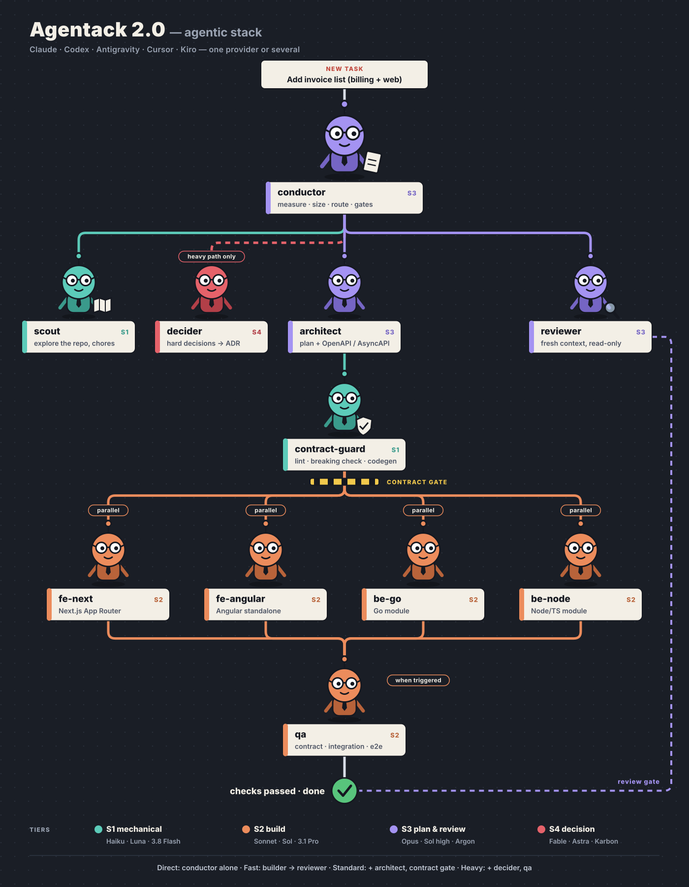

# Agentack 2.1 — agentic stack

**A conductor-led, multi-provider agent workflow for full stack projects, in any language and architecture.**

Call `/agentack` in Claude Code, Codex, Antigravity or Kiro and your session becomes a *conductor*: it measures the
task, picks the smallest crew that can finish it correctly, and routes each role to the right
model on the agent CLIs you already use: Claude Code, Codex, Antigravity, Cursor, Kiro.

It reads your project first: Go, Java, Kotlin, C#, Node/TypeScript, Python, Ruby, PHP, Elixir, Rust
on the backend; Angular, React, Next.js, Vue, Nuxt, Svelte, Flutter and more on the front; a modular
monolith, microservices, a full stack framework or a classic monolith. The crew takes the shape of
the project instead of the other way round.

> 🇹🇷 Türkçe: [README.tr.md](README.tr.md) · Coming from 0.1? See [Upgrading](#upgrading-from-01).

<p align="center">
  
</p>

## Highlights

- **One provider or several.** Roles are bound to tiers, not models. A single provider can run
  the whole workflow; two or three add an independent reviewer and fallback.
- **Any stack, any architecture.** `/agentack init` reads the repository: its units, languages,
  frameworks, architecture, contracts and commands. There is one backend and one frontend
  builder role; in your project they become `be-go`, `be-java`, `be-csharp`, `fe-angular`,
  `fe-next` or `fs-next`, each with its own commands, rules and conventions. Nobody is asked to
  describe the project.
- **Right-sized crews.** Ten roles exist, most tasks need two, a typo fix needs none. The
  conductor measures first and calls a role only when its trigger is present.
- **Backend designed before it is coded, when it matters.** A schema change on live data, rules
  that must survive concurrency, a write across modules or services: the `backend-architect`
  first fixes the data model, migration steps, invariants, transaction boundaries, failure modes
  and the tests that must exist. The builder implements that note and the reviewer checks
  against it. Routine backend changes skip it.
- **Design before code, when it matters.** A new screen or a visual redesign first goes to the
  `designer`, on the provider that is best at visual work: a design note with every state, an
  optional static mockup and an asset list. Routine UI changes skip it. Images in that list can
  be generated through Codex or Antigravity (experimental); review then compares screenshots
  with the design.
- **Tests at three levels.** Builders write and run the unit tests for their own code; `qa` adds
  contract, integration and e2e tests when behavior crosses a boundary; the reviewer checks that
  the tests prove behavior. Nothing is done until the project's checks pass.
- **Independent review.** With more than one provider, review runs on a different vendor than
  the one that wrote the code.
- **Each model is briefed its own way.** Latitude for the models that plan, every step spelled
  out for the literal ones, rules and examples for the mechanical ones. The strongest model gets
  only the open question and the evidence, gathered for it by cheaper roles.
- **It adapts instead of asking.** A model your account does not have is skipped: the role runs
  on the same tier of another provider, or one tier down when nobody has it. A model you do have
  is never traded down.
- **Usage-limit fallback** (optional). When a provider nears or hits its limit, the same tier on
  the next provider takes over, mid-task if needed.
- **Priorities, in order: task, context, tokens.** The work is finished correctly; every agent gets
  the part of the project it needs and no more; then the fewest agents and tokens.

## Quick start

```bash
git clone https://github.com/osrbck/skillbook.git ~/skillbook
~/skillbook/install.sh agentack --all   # Claude Code, Codex, Antigravity and Kiro; or one of: (no flag) --codex --agy --kiro
```

Restart your agent, then:

```
/agentack setup
```

Setup looks at what is installed and signed in on *your* machine, asks only what that leaves
open, verifies every model with a one-word prompt, and tells you exactly what to fix if something
is missing. There is no fixed script, because no two machines are set up the same way.

Then, in a project:

```
/agentack init
```

or just give it a task: the first task in a project runs `init` by itself and reports what it
found before it starts.

## Commands

| Command | What it does |
|---|---|
| `/agentack <task>` | Size the task, run the crew it needs, report |
| `/agentack setup` | Choose providers and options for this machine; re-run any time |
| `/agentack init` | Read this project: units, stacks, architecture, contracts, commands |
| `/agentack verify` | Re-test every model and provider; brings back a provider you fixed |
| `/agentack roster` | Who does what: role (with this project's builder names), tier, model, fit score, fallbacks |
| `/agentack limits` | Usage per provider and anything currently skipped |
| `/agentack doctor` | Health check: CLIs, sign-in, environment, next steps |
| `/agentack resume` | Continue an unfinished task, also from another host |

```
/agentack Add an invoice list endpoint to billing and a list page in the admin app
/agentack fix the typo in the invoice empty state
```

The conductor commits or opens a PR only when you ask.

**Changing the roster.** The roster that setup gives you is a starting point. Ask for a change
in plain words and the conductor applies it and shows the new roster:

```
/agentack put the mechanical work on Kiro
/agentack let Codex review
/agentack go back to the default roster
```

Behind that are `setup` flags you can also run by hand (`--role scout=kiro,claude`,
`--model agy:S2=<model>`, `--rate agy:backend=3`, `--reset`); see
[references/providers.md](references/providers.md). `/agentack verify` tests every model again,
including the ones that were dropped earlier, so a model you gained with a new plan comes back.

## Your project

`init` writes what it finds to `.agentack.json` at the project root (safe to commit) and reports
in a few lines:

| It finds | From | And uses it for |
|---|---|---|
| **Units**: every app or service, its language, framework and layer | manifests: `go.mod`, `pom.xml`, `*.csproj`, `package.json`, `pyproject.toml`, `Gemfile`, `composer.json`, `Cargo.toml`, `mix.exs`, `pubspec.yaml` … | naming the builders (`be-java`, `fe-angular`, `fs-next`) and giving each its stack's conventions |
| **Architecture**: modular monolith, microservices, full stack app, monolith, serverless, frontend only | module folders, service folders, container and Kubernetes config, boundary tools | the boundary rules builders follow and reviewers check |
| **Contracts**: OpenAPI, AsyncAPI, protobuf, GraphQL, JSON Schema, shared types (tRPC) | spec files, `buf.yaml`, codegen configs | the contract gate and its tools |
| **Commands**: test, lint, typecheck, build, contract check | package scripts, Makefile, justfile, Taskfile, defaults per stack | the evidence every builder must show |

Whatever the scan cannot settle, the conductor looks up itself in the README or the CI config and
records with `init --set`; it does not turn into a question. A modular monolith still gets
everything Agentack started with (module boundaries, contracts per module, outbox events), and a
microservices repository gets timeouts, idempotency and deploy-order checks instead. Rules per
architecture: [`references/architecture/`](skills/agentack/references/architecture/).

## Tiers

| Tier | Purpose | Roles | Claude | Codex | Antigravity | Kiro | Cursor |
|---|---|---|---|---|---|---|---|
| **S4** | hard-to-reverse decisions | decider | Fable | GPT-6 Astra (high) | Gemini 4 Karbon, else Argon | a model you name | a model you name |
| **S3** | plan, design & review | conductor, architect, backend-architect, designer, reviewer | Opus | GPT-6 Astra, else Sol (high) | Gemini 4 Argon, else 3.1 Pro | a model you name | a model you name |
| **S2** | build | backend, frontend (be-/fe-/fs-&lt;stack&gt;), qa | Sonnet | GPT-6.1 Sol (medium) | Gemini 3.1 Pro | Auto | Composer |
| **S1** | mechanical | scout, contract-guard | Haiku | GPT-6 Luna | Gemini 3.8 Flash | Auto | Auto |
| | **can conduct** | | yes | yes | yes | yes, on a named Opus-class model | no |

Four of the five can host the conductor: Claude Code, Codex, Antigravity and Kiro. Cursor is a
worker only. Kiro and Cursor cover S1 and S2 out of the box (Auto, Composer); for review and
decision roles they need a model you name, because Auto does not say which model answers. These
are defaults: what your roster really contains depends on your
accounts and is shown by `/agentack roster`. Details: [`providers.md`](skills/agentack/references/providers.md).

## Strengths

Tiers say how capable a model is; strengths say what a provider is good at. Each provider is
rated 1–5 per kind of work, and the roster keeps it on what it does well.

| Provider | decide | plan | review | visual | backend | frontend | test | mechanical |
|---|---|---|---|---|---|---|---|---|
| Claude Code | 5 | 5 | 5 | 4 | 5 | 4 | 5 | 4 |
| Codex | 5 | 4 | 4 | 4 | 4 | 4 | 4 | 3 |
| Antigravity | 4 | 4 | 4 | 5 | 2 | 2 | 2 | 2 |
| Kiro | 3 | 3 | 3 | 3 | 3 | 3 | 3 | 3 |
| Cursor | 3 | 3 | 3 | 3 | 3 | 3 | 3 | 3 |

Kiro and Cursor are 3 throughout: their Auto routers have no comparable public numbers. Your provider order decides, with two corrections: a provider rated weak (2 or lower) at a kind
of work does it only as a last resort, and a specialty such as visual review goes to the best
rated. So Gemini plans, reviews and checks UI, but writes code only when nothing else is
available. Setup shows this scorecard before you choose; `--rate` changes any number. Ratings are
dated and sourced in [`strengths.md`](skills/agentack/references/strengths.md).

## Briefing styles

| Models | The brief contains |
|---|---|
| Opus, GPT-6 Astra and peers (S3) | goal, context, constraints, what done looks like |
| Sonnet and peers (S2) | named files, steps, output shape, boundaries |
| GPT-6.1 Sol, Auto routers | every step in order, nothing left implicit |
| Fable, GPT-6 Astra, Gemini 4 Karbon (S4) | the open question plus the evidence, as to a peer |
| Haiku, GPT-6 Luna, Gemini 3.8 Flash (S1) | exact rules with input/output examples, small batches, spot checks |

The conductor gets the right template for whichever model a role runs on. The strongest model is
called at three points only: a hard-to-reverse decision, a second opinion on it, and an
escalation after two failed attempts.

## Paths

| Path | When | Crew |
|---|---|---|
| **Direct** | ≤ 2 files, location known, no contract/schema/auth impact, a command can verify it | the conductor alone |
| **Fast** | one module, service or feature, one layer, no contract change | one builder → reviewer |
| **Standard** | a contract changes, two modules or services, > 5 files, or unclear cause | architect → contract gate → builders → reviewer (+ qa when needed) |
| **Heavy** | new module or service, schema change, auth/payments, breaking contract | decider (+ second opinion) → Standard crew + qa |

Two gates never move: **no build before the contract check passes**, and **nothing is done before
an independent review** (every path except Direct). When a task turns out wider than measured,
the conductor moves it up a path. Details: [`sizing.md`](skills/agentack/references/sizing.md).

## Models and limits

**Missing models** are handled automatically, always: a model that is not on your account
(not listed, refused by `verify`, or refused during a run) is skipped and remembered.

**Usage limits** are handled when fallback is on:

- A provider is skipped after it reports a limit (until the reset time) or when measured usage
  passes your threshold (default 85%). Usage is measured for Codex, Kiro, Antigravity
  (experimental) and, with the optional status line hook, Claude Code.
- Same tier first. Builders may drop one tier as a last resort. Reviewer, decider and architect
  are never downgraded for a limit: the work stops and tells you when it resets.
- A run cut off by a limit is continued by the next provider from the same working tree.
- Nothing is asked during work. Every switch appears in the closing report.

## How it runs

```
/agentack → conductor (your Claude Code, Codex, Antigravity or Kiro session)
               │  project profile → measure → size → path → gates
               ▼
            agentack.py dispatch ── role → unit → tier → provider + model
               ├─ claude -p · codex exec · agy -p · agent -p · kiro-cli chat --no-interactive
               └─ in Claude Code, Claude workers run as native subagents
```

- Workers run headless in your repository with a narrow brief plus the slice of the project
  profile their role needs (a builder: its unit, commands, architecture rules and stack
  conventions; a reviewer: the map and the review checks), and never commit.
- Read-only roles are enforced by the CLI where possible and verified with `git status` after every run.
- Runs, logs and briefs live in `<project>/.agentack/` (git-ignored automatically).
- The helper is plain Python with no dependencies. It talks only to the agent CLIs on your machine.
- `.agentack.json` also lets a project restrict providers: `{"allowed_providers": ["claude"]}`.
  It cannot change anything else about your machine: other settings in it are ignored.

Contracts come first wherever a project has them: the contract changes before the code, generated
code is never edited, and breaking changes need a new version and your approval. See
[`contracts.md`](skills/agentack/references/contracts.md).

## Requirements

- **Conductor:** Claude Code, Codex, Antigravity (app, IDE or CLI) or Kiro (IDE or CLI), on a
  plan-and-review class model (Opus, GPT-6 Astra, Gemini 4 Argon or above; in Kiro a named
  Opus-class model, not Auto). On a smaller model Agentack warns and asks before continuing.
- **Providers:** at least one of Claude Code, Codex, Antigravity (`agy`), Cursor CLI, Kiro CLI.
- Python 3.8+ and git, on macOS, Linux or WSL. Your project in a git repository.

Update with `cd ~/skillbook && git pull && ./install.sh agentack --all`; remove with `./install.sh agentack --uninstall`.

### Upgrading

**From 2.0:** run `./install.sh agentack --all` again (from skillbook). The four stack-specific builders (`be-go`, `be-node`,
`fe-next`, `fe-angular`) are now the project-aware `backend` and `frontend` roles; the old names
still work as aliases. Run `/agentack init` once per project, or just give it a task.

**From 0.1:** 2.0 replaced the Claude-only 0.1 under the same name and command. `install.sh agentack` installs the new
skill over the old one and moves the ten global subagents that 0.1 put in `~/.claude/agents/`
into `~/.claude/backups/` (2.0 keeps its role prompts inside the skill, so nothing global is
needed). Then run `/agentack setup` once. Project guides written for 0.1 keep working.

## Status

| Provider | State |
|---|---|
| Claude Code | tested against the real CLI |
| Codex, Antigravity, Cursor, Kiro | written from each CLI's documentation and covered by simulated tests |
| Project scan (`init`) | covered by tests on sample repositories; real repositories will surface gaps |
| Image generation | experimental: depends on each CLI's own image tool |

Model names and CLI flags change often. `/agentack verify` proves what works on your machine,
and reports of what you see there are very welcome.

## Repository

Agentack lives in [skillbook](../../README.md):

```
skillbook/
├── install.sh                # ./install.sh agentack [--codex|--agy|--kiro|--all]
├── skills/agentack/
│   ├── SKILL.md              # the conductor
│   ├── roles/                # 10 provider- and stack-neutral role prompts
│   ├── references/           # sizing, providers, strengths, contracts, stacks, architecture/
│   ├── templates/            # plan, backend design, design note, ADR, briefs per model style
│   ├── scripts/              # agentack.py + agentack_core
│   └── install.hook.sh       # 0.1 / preview migration, CLI detection
├── docs/agentack/            # diagrams
└── tests/agentack/           # end-to-end tests against fake agent CLIs
```

```bash
python3 -m unittest discover -s tests/agentack -v   # from the skillbook root
```

Contributions are welcome: see [CONTRIBUTING.md](CONTRIBUTING.md). Licensed under [MIT](../../LICENSE).

Agentack is a community project and is not affiliated with Anthropic, OpenAI, Google, Cursor or AWS.
