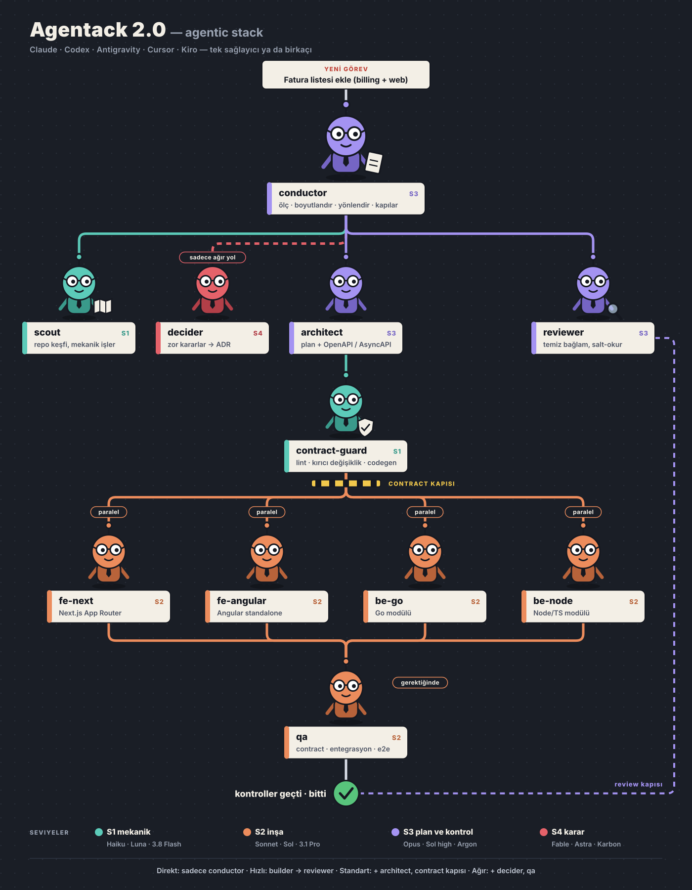

# Agentack 2.1 — agentic stack

**Her dilde ve her mimaride full stack projeler için, conductor yönetiminde çok sağlayıcılı ajan workflow'u.**

Claude Code, Codex, Antigravity ya da Kiro'da `/agentack` yazınca oturumun bir *conductor*'a dönüşür: işi ölçer, işi
doğru bitirebilecek en küçük ekibi seçer ve her rolü zaten kullandığın ajan CLI'larındaki doğru
modele yönlendirir: Claude Code, Codex, Antigravity, Cursor, Kiro.

Önce projeni okur: backend'de Go, Java, Kotlin, C#, Node/TypeScript, Python, Ruby, PHP, Elixir,
Rust; önyüzde Angular, React, Next.js, Vue, Nuxt, Svelte, Flutter ve dahası; modüler monolit,
mikroservis, full stack framework ya da klasik monolit. Ekip projeye uyar, proje ekibe değil.

> 🇬🇧 English: [README.md](README.md) · Eski sürümden mi geliyorsun? Bkz. [Yükseltme](#yükseltme).

<p align="center">
  
</p>

## Öne çıkanlar

- **Tek sağlayıcı ya da birkaçı.** Roller modellere değil seviyelere bağlı. Tek sağlayıcı bütün
  workflow'u çalıştırır; iki üç sağlayıcı bağımsız review ve yedekleme ekler.
- **Her stack, her mimari.** `/agentack init` repoyu okur: birimleri, dilleri, framework'leri,
  mimariyi, contract'ları ve komutları. Bir backend ve bir frontend builder rolü var; senin
  projende bunlar `be-go`, `be-java`, `be-csharp`, `fe-angular`, `fe-next` ya da `fs-next` olur,
  her biri kendi komutları, kuralları ve dil alışkanlıklarıyla. Kimseden projeyi anlatması
  istenmez.
- **İşe göre ekip.** On rol var, çoğu iş ikisiyle biter, bir yazım hatası hiçbirini
  gerektirmez. Conductor önce ölçer; bir rolü ancak tetikleyicisi varsa çağırır.
- **Gerektiğinde önce backend tasarımı.** Canlı veride şema değişikliği, eşzamanlılıkta bozulmaması
  gereken kurallar, modüller ya da servisler arası yazma: `backend-architect` önce veri modelini,
  migration adımlarını, değişmez kuralları, transaction sınırlarını, hata senaryolarını ve mutlaka
  olması gereken testleri belirler. Builder bu notu uygular, reviewer ona göre kontrol eder.
  Sıradan backend işleri bu adımı atlar.
- **Gerektiğinde önce tasarım.** Yeni bir ekran ya da görsel yenileme önce `designer`'a gider;
  görsel işte en iyi sağlayıcıda çalışır: her durumu içeren bir tasarım notu, isteğe bağlı statik
  bir maket ve bir görsel listesi çıkarır. Sıradan arayüz işleri bu adımı atlar. Listedeki
  resimler Codex ya da Antigravity üzerinden üretilebilir (deneysel); review ekran görüntülerini
  tasarımla karşılaştırır.
- **Üç katmanlı test.** Builder kendi kodunun unit testlerini yazar ve çalıştırır; davranış bir
  sınırı geçtiğinde `qa` contract, entegrasyon ve e2e testlerini ekler; reviewer testlerin
  davranışı kanıtlayıp kanıtlamadığına bakar. Projenin kontrolleri geçmeden iş bitmez.
- **Bağımsız review.** Birden fazla sağlayıcı varsa review, kodu yazandan farklı bir sağlayıcıda yapılır.
- **Her modele kendi dilinde brief.** Plan yapan modellere serbestlik, harfiyen uygulayan modellere
  adım adım talimat, mekanik modellere kural ve örnek. En güçlü modele sadece açık soru ve ucuz
  rollerin onun için topladığı kanıt gider.
- **Sormak yerine uyum sağlar.** Hesabında olmayan model atlanır: rol aynı seviyedeki başka bir
  sağlayıcıda, o seviye kimsede yoksa bir alt seviyede çalışır. Elinde olan model asla düşürülmez.
- **Limit bazlı model değişimi** (isteğe bağlı). Bir sağlayıcı kullanım limitine yaklaşınca aynı
  seviyedeki sıradaki sağlayıcı işi devralır; gerekirse görevin ortasında.
- **Öncelik sırası: görev, bağlam, token.** İş doğru bitsin; her ajan projenin ihtiyacı olan
  kısmını alsın, fazlasını değil; sonra en az ajan ve en az token.

## Hızlı başlangıç

```bash
git clone https://github.com/osrbck/skillbook.git ~/skillbook
~/skillbook/install.sh agentack --all   # Claude Code, Codex, Antigravity ve Kiro; tek biri için: (bayraksız) --codex --agy --kiro
```

Ajanını yeniden başlat, sonra:

```
/agentack setup
```

Setup *senin* bilgisayarında neyin kurulu ve giriş yapılmış olduğuna bakar, sadece açıkta kalanı
sorar, her modeli tek kelimelik bir istekle dener ve bir eksik varsa tam olarak neyi düzeltmen
gerektiğini söyler. Sabit bir senaryosu yoktur, çünkü iki bilgisayarın kurulumu aynı olmaz.

Sonra bir projede:

```
/agentack init
```

ya da doğrudan görev ver: bir projedeki ilk görev `init`'i kendisi çalıştırır ve başlamadan önce
ne bulduğunu raporlar.

## Komutlar

| Komut | Ne yapar |
|---|---|
| `/agentack <görev>` | İşi boyutlandırır, gereken ekibi çalıştırır, raporlar |
| `/agentack setup` | Bu bilgisayar için sağlayıcıları ve seçenekleri belirler; istediğin zaman tekrar çalıştır |
| `/agentack init` | Bu projeyi okur: birimler, stack'ler, mimari, contract'lar, komutlar |
| `/agentack verify` | Her modeli ve sağlayıcıyı yeniden dener; düzelttiğin sağlayıcıyı geri getirir |
| `/agentack roster` | Kadro: rol (bu projedeki builder adlarıyla), seviye, model, uygunluk puanı, yedekler |
| `/agentack limits` | Sağlayıcı başına kullanım ve şu an atlananlar |
| `/agentack doctor` | Sağlık kontrolü: CLI'lar, giriş, ortam, sonraki adımlar |
| `/agentack resume` | Yarım kalan işe devam eder; başka bir host'tan da olur |

```
/agentack billing modülüne fatura listeleme endpoint'i ve admin uygulamasında liste sayfası ekle
/agentack fatura boş durum metnindeki yazım hatasını düzelt
```

Conductor sadece sen istersen commit atar ya da PR açar.

**Kadroyu değiştirmek.** Setup'ın verdiği kadro bir başlangıçtır. Değişikliği düz cümleyle iste;
conductor uygular ve yeni kadroyu gösterir:

```
/agentack mekanik işleri Kiro'ya ver
/agentack review'u Codex yapsın
/agentack varsayılan kadroya dön
```

Arkasında elle de çalıştırabileceğin `setup` bayrakları var (`--role scout=kiro,claude`,
`--model agy:S2=<model>`, `--rate agy:backend=3`, `--reset`); bkz.
[references/providers.md](references/providers.md). `/agentack verify` her modeli yeniden dener,
daha önce düşürülenler dahil; yeni planla gelen bir model böylece kadroya geri döner.

## Projen

`init` bulduklarını proje kökündeki `.agentack.json` dosyasına yazar (commit'lenebilir) ve birkaç
satırla raporlar:

| Ne bulur | Nereden | Ne için kullanır |
|---|---|---|
| **Birimler**: her uygulama ya da servis, dili, framework'ü ve katmanı | manifest'ler: `go.mod`, `pom.xml`, `*.csproj`, `package.json`, `pyproject.toml`, `Gemfile`, `composer.json`, `Cargo.toml`, `mix.exs`, `pubspec.yaml` … | builder'lara ad vermek (`be-java`, `fe-angular`, `fs-next`) ve her birine kendi stack'inin alışkanlıklarını vermek |
| **Mimari**: modüler monolit, mikroservis, full stack uygulama, monolit, serverless, sadece önyüz | modül klasörleri, servis klasörleri, container ve Kubernetes ayarları, sınır araçları | builder'ların uyduğu, reviewer'ın kontrol ettiği sınır kuralları |
| **Contract'lar**: OpenAPI, AsyncAPI, protobuf, GraphQL, JSON Schema, paylaşılan tipler (tRPC) | spec dosyaları, `buf.yaml`, codegen ayarları | contract kapısı ve araçları |
| **Komutlar**: test, lint, typecheck, build, contract kontrolü | paket script'leri, Makefile, justfile, Taskfile, stack başına varsayılanlar | her builder'ın göstermesi gereken kanıt |

Taramanın netleştiremediğini conductor README'ye ya da CI ayarlarına bakarak kendisi bulur ve
`init --set` ile kaydeder; soruya dönüşmez. Modüler monolit, Agentack'in başından beri sunduğu her
şeyi almaya devam eder (modül sınırları, modül başına contract, outbox event'leri); mikroservis
reposu ise bunların yerine timeout, idempotency ve deploy sırası kontrollerini alır. Mimari başına
kurallar: [`references/architecture/`](skills/agentack/references/architecture/).

## Seviyeler

| Seviye | Amaç | Roller | Claude | Codex | Antigravity | Kiro | Cursor |
|---|---|---|---|---|---|---|---|
| **S4** | geri dönüşü pahalı kararlar | decider | Fable | GPT-6 Astra (yüksek efor) | Gemini 4 Karbon, yoksa Argon | adını verdiğin model | adını verdiğin model |
| **S3** | plan, tasarım ve kontrol | conductor, architect, backend-architect, designer, reviewer | Opus | GPT-6 Astra, yoksa Sol (yüksek efor) | Gemini 4 Argon, yoksa 3.1 Pro | adını verdiğin model | adını verdiğin model |
| **S2** | inşa | backend, frontend (be-/fe-/fs-&lt;stack&gt;), qa | Sonnet | GPT-6.1 Sol (orta efor) | Gemini 3.1 Pro | Auto | Composer |
| **S1** | mekanik iş | scout, contract-guard | Haiku | GPT-6 Luna | Gemini 3.8 Flash | Auto | Auto |
| | **conductor olabilir** | | evet | evet | evet | evet, adı belli Opus sınıfı bir modelde | hayır |

Beş sağlayıcının dördü conductor'a ev sahipliği yapabilir: Claude Code, Codex, Antigravity ve
Kiro. Cursor yalnızca işçidir. Kiro ve Cursor S1 ile S2'yi olduğu gibi karşılar (Auto, Composer);
review ve karar rolleri için adını verdiğin bir model gerekir, çünkü Auto hangi modelin yanıt
verdiğini söylemez. Bunlar varsayılanlardır: kadronda gerçekte ne
olduğu hesaplarına bağlıdır ve `/agentack roster` ile görülür.
Ayrıntı: [`providers.md`](skills/agentack/references/providers.md).

## Güçlü yönler

Seviye bir modelin ne kadar yetenekli olduğunu söyler; güçlü yönler bir sağlayıcının neyde iyi
olduğunu. Her sağlayıcı iş türü başına 1–5 arası puanlanır ve kadro onu iyi yaptığı işte tutar.

| Sağlayıcı | karar | plan | review | görsel | backend | frontend | test | mekanik |
|---|---|---|---|---|---|---|---|---|
| Claude Code | 5 | 5 | 5 | 4 | 5 | 4 | 5 | 4 |
| Codex | 5 | 4 | 4 | 4 | 4 | 4 | 4 | 3 |
| Antigravity | 4 | 4 | 4 | 5 | 2 | 2 | 2 | 2 |
| Kiro | 3 | 3 | 3 | 3 | 3 | 3 | 3 | 3 |
| Cursor | 3 | 3 | 3 | 3 | 3 | 3 | 3 | 3 |

Kiro ve Cursor her işte 3'tür: Auto yönlendiricilerinin karşılaştırılabilir açık bir ölçümü yok.
Sırayı senin sağlayıcı önceliğin belirler; iki düzeltme uygulanır: bir iş türünde zayıf puanlı
(2 ve altı) sağlayıcı o işi ancak son çare olarak yapar, görsel review gibi uzmanlık işleri de en
yüksek puanlıya gider. Yani Gemini plan yapar, review yapar, arayüzü kontrol eder; ama kodu ancak
başka seçenek yoksa yazar. Setup, seçim yapmadan önce bu tabloyu gösterir; `--rate` ile her puan
değiştirilebilir. Puanların tarihi ve dayanakları:
[`strengths.md`](skills/agentack/references/strengths.md).

## Brief stilleri

| Modeller | Brief'te ne olur |
|---|---|
| Opus, GPT-6 Astra ve dengi (S3) | hedef, bağlam, kısıtlar, "bitti" neye benzer |
| Sonnet ve dengi (S2) | adı belli dosyalar, adımlar, çıktı biçimi, sınırlar |
| GPT-6.1 Sol, Auto yönlendiriciler | sırayla her adım, hiçbir şey örtük değil |
| Fable, GPT-6 Astra, Gemini 4 Karbon (S4) | açık soru ve kanıt, bir meslektaşa sorar gibi |
| Haiku, GPT-6 Luna, Gemini 3.8 Flash (S1) | girdi/çıktı örnekli kesin kurallar, küçük partiler, örnekleme kontrolü |

Conductor, rol hangi modelde çalışıyorsa ona uygun şablonu alır. En güçlü model sadece üç noktada
çağrılır: geri dönüşü pahalı bir karar, o karara ikinci görüş ve iki başarısız denemeden sonraki
eskalasyon.

## Yollar

| Yol | Ne zaman | Ekip |
|---|---|---|
| **Direkt** | en fazla 2 dosya, yeri belli, contract/şema/auth etkisi yok, bir komutla doğrulanabiliyor | sadece conductor |
| **Hızlı** | tek modül, servis ya da özellik, tek katman, contract değişmiyor | bir builder → reviewer |
| **Standart** | contract değişiyor, iki modül ya da servis, 5'ten fazla dosya ya da sebep belirsiz | architect → contract kapısı → builder'lar → reviewer (gerekirse qa) |
| **Ağır** | yeni modül ya da servis, şema değişikliği, auth/ödeme, kırıcı contract | decider (+ ikinci görüş) → Standart ekip + qa |

İki kapı hiç esnemez: **contract kontrolü geçmeden inşa başlamaz** ve **bağımsız review olmadan
iş bitmiş sayılmaz** (Direkt yol hariç). İş ölçülenden geniş çıkarsa conductor onu bir üst yola
taşır. Ayrıntı: [`sizing.md`](skills/agentack/references/sizing.md).

## Modeller ve limitler

**Eksik modeller** her zaman otomatik ele alınır: hesabında olmayan model (listede yoksa, `verify`
reddederse ya da çalışma sırasında reddedilirse) atlanır ve hatırlanır.

**Kullanım limitleri** değişim açıkken ele alınır:

- Bir sağlayıcı limit bildirdiğinde (sıfırlanma saatine kadar) ya da ölçülen kullanım eşiği
  geçtiğinde (varsayılan %85) atlanır. Kullanım Codex, Kiro, Antigravity (deneysel) ve isteğe
  bağlı durum çubuğu kancasıyla Claude Code için ölçülür.
- Önce aynı seviye. Builder'lar son çare olarak bir seviye düşebilir. Reviewer, decider ve
  architect limit yüzünden asla düşürülmez: iş durur ve ne zaman sıfırlanacağını söyler.
- Limit yüzünden yarıda kalan görevi sıradaki sağlayıcı aynı çalışma klasöründen devralır.
- Çalışma sırasında soru sorulmaz. Her değişim kapanış raporunda yazar.

## Nasıl çalışır

```
/agentack → conductor (Claude Code, Codex, Antigravity ya da Kiro oturumun)
               │  proje profili → ölç → boyutlandır → yol → kapılar
               ▼
            agentack.py dispatch ── rol → birim → seviye → sağlayıcı + model
               ├─ claude -p · codex exec · agy -p · agent -p · kiro-cli chat --no-interactive
               └─ Claude Code'da Claude işçileri yerel alt ajan olarak çalışır
```

- İşçiler reponda arayüzsüz çalışır, asla commit atmaz. Ellerinde dar bir brief ve proje
  profilinin rollerine düşen kısmı olur (builder: kendi birimi, komutları, mimari kuralları ve
  stack alışkanlıkları; reviewer: projenin haritası ve review kontrolleri).
- Salt-okur roller mümkün olan yerde CLI tarafından zorlanır, her çalıştırmadan sonra `git status` ile doğrulanır.
- Çalıştırmalar, kayıtlar ve brief'ler `<proje>/.agentack/` altında durur (git'e girmez).
- Yardımcı script saf Python'dır, bağımlılığı yoktur. Sadece bilgisayarındaki ajan CLI'larıyla konuşur.
- `.agentack.json` ile bir proje sağlayıcıları da kısıtlayabilir: `{"allowed_providers": ["claude"]}`.
  Bilgisayarınla ilgili başka hiçbir şeyi değiştiremez: içindeki diğer ayarlar yok sayılır.

Contract'ı olan her projede contract önce gelir: kodu değil önce contract'ı değiştirirsin, üretilen
kod elle düzenlenmez, kırıcı değişiklik yeni sürüm ve senin onayını ister. Bkz.
[`contracts.md`](skills/agentack/references/contracts.md).

## Gereksinimler

- **Conductor:** Claude Code, Codex, Antigravity (uygulama, IDE ya da CLI) ya da Kiro (IDE ya da
  CLI), plan ve kontrol sınıfı bir modelde (Opus, GPT-6 Astra, Gemini 4 Argon ya da üstü; Kiro'da
  Auto değil, adı belli Opus sınıfı bir model). Daha küçük bir modelde Agentack uyarır ve devam
  etmeden önce onay ister.
- **Sağlayıcılar:** Claude Code, Codex, Antigravity (`agy`), Cursor CLI, Kiro CLI'dan en az biri.
  CLI'ın kurulu ve giriş yapılmış olması yeterli. İçinde çalışman gerekmez: `/agentack`'i masaüstü
  uygulamasından ya da IDE'den çağırırsın, işçiler arka planda CLI'lar üzerinden çalışır.
- Python 3.8+ ve git; macOS, Linux ya da WSL. Projen bir git reposu olmalı.

Güncelleme: `cd ~/skillbook && git pull && ./install.sh agentack --all` · Kaldırma: `./install.sh agentack --uninstall`.

### Yükseltme

**2.0'dan:** skillbook içinde `./install.sh agentack --all`'u tekrar çalıştır. Stack'e özel dört builder (`be-go`, `be-node`,
`fe-next`, `fe-angular`) artık projeyi tanıyan `backend` ve `frontend` rolleri; eski adlar takma
ad olarak çalışmaya devam eder. Her projede bir kez `/agentack init` çalıştır ya da doğrudan
görev ver.

**0.1'den:** 2.0, sadece Claude ile çalışan 0.1'in yerini aynı ad ve komutla aldı. `install.sh agentack` yeni skill'i
eskisinin üstüne kurar ve 0.1'in `~/.claude/agents/` altına koyduğu on global alt ajanı
`~/.claude/backups/` altına taşır (2.0 rol talimatlarını skill'in içinde tutar, global bir şeye
gerek kalmaz). Sonra bir kez `/agentack setup` çalıştır. 0.1 için yazılmış proje rehberleri
çalışmaya devam eder.

## Durum

| Sağlayıcı | Durum |
|---|---|
| Claude Code, Codex, Antigravity, Kiro, Cursor | gerçek CLI'larla test edildi; ayrıca simülasyon testlerinden geçiyor |
| Proje taraması (`init`) | örnek repolar üzerinde testlerle doğrulandı; gerçek repolar eksikleri gösterecek |
| Resim üretimi | deneysel: her CLI'ın kendi resim aracına bağlı |

Model adları ve CLI bayrakları sık değişiyor. `/agentack verify` senin bilgisayarında neyin
çalıştığını kanıtlar; orada gördüklerini bildirirsen çok yardımcı olur.

Katkılar için [CONTRIBUTING.md](CONTRIBUTING.md) · Lisans: [MIT](../../LICENSE).

Agentack bir topluluk projesidir; Anthropic, OpenAI, Google, Cursor veya AWS ile bağlantılı değildir.
