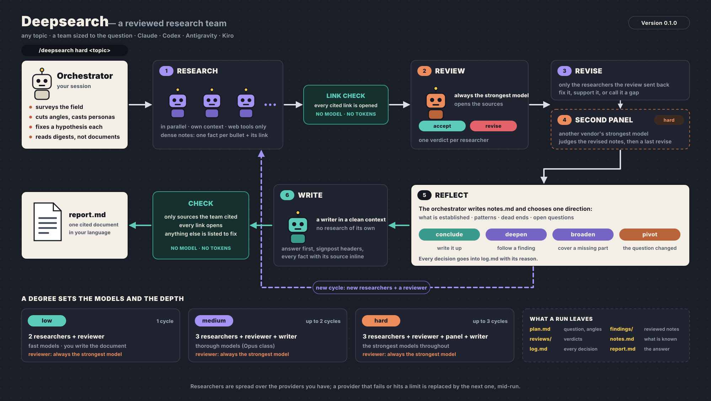

# deepsearch

**Research a topic with a team of agents, and have the result reviewed before you read it.**
`/deepsearch hard <topic>` turns your session into the orchestrator of a research team: it frames
the question, sizes the team to it, gives each researcher a persona and an angle of their own,
lets them work in parallel on the web, hands their notes to a reviewer on the strongest model
who checks the sources, sends back what does not hold, and has a writer turn what survived into
one cited document whose sources are checked.

> 🇹🇷 Türkçe: [README.tr.md](README.tr.md)

```
/deepsearch hard Is sodium-ion ready to replace LFP in grid storage?
```

<p align="center">
  
</p>

Works in **Claude Code, Codex, Antigravity and Kiro**: desktop app, IDE or CLI.

## How it works

A run leaves a folder you can read and pick up later:

```
research/2026-11-13-is-sodium-ion-ready-to-replace-lfp-in-grid-storage/
├── survey.md      the orchestrator's map of the field, made before the plan
├── plan.md        the question, the scope, each agent's persona, angle and hypothesis
├── findings/      researcher-1.md …   dense, cited notes, as revised after review
├── reviews/       reviewer-1.md, panel-1.md
├── digest.md      takeaways, gaps and verdicts, cut from the documents without a model
├── notes.md       what the run knows so far: established, patterns, dead ends, open questions
├── log.md         every stage, verdict, link check and decision, with the time
└── report.md      the final document
```

- **A degree sets the team.** You choose how much the question deserves; with no degree it asks.

  | Degree | Team | Researchers run on | Reviewer runs on | Cycles |
  |---|---|---|---|---|
  | `low` | 2 researchers + 1 reviewer; you write | fast models (Sonnet, GPT-6.1 Sol, Gemini Flash) | the strongest | 1 |
  | `medium` | 3 researchers + 1 reviewer + 1 writer | thorough models (Opus, GPT-6 Astra, Gemini 4 Argon) | the strongest | up to 2 |
  | `hard` | 3 researchers + 1 reviewer + a second panel + 1 writer | the strongest (Fable high, Astra high, Argon high) | the strongest | up to 3 |

- **The question sets the head count.** The degree sets the models and the depth; the
  orchestrator counts the independent parts of the question and takes one researcher for each,
  from one (a single focused question) up to eight (a large set to cover). A researcher without
  an angle of their own only repeats searches.

- **The reviewer is never the cheap seat.** At every degree the review runs on the strongest
  model of your first provider; at `hard` the second panel runs on another vendor's strongest
  model, where you have one. The reviewer opens the sources behind each conclusion and ends with a verdict per researcher.
- **Personas with a job.** Each researcher works as the acclaimed specialist of the field their
  angle belongs to; the reviewer as the professor who wrote the standard book on the topic.
  A persona sets the standard of work. It is never a real person's name.
- **Assignments a stranger could carry out.** Every researcher starts with a clean context and
  gets an objective, what is *not* theirs, where to start looking, a hypothesis and questions.
  The orchestrator cuts the question the way specialists would own it (the evidence, the
  mechanism, the economics, the opposing school), so the team covers more ground than one model
  asked several times, and no two run the same searches.
- **Dense notes, not essays.** Researchers return one fact per bullet with its link, a takeaway
  and the gaps per question, within a budget of searches. Everyone downstream reads less, and
  every claim can be checked against its source.
- **A writer with a clean context.** At `medium` and `hard` the final document is written by an
  agent that sees only the reviewed notes, the reviews and the orchestrator's notes: answer
  first, headers that carry the argument, every fact with its source inline.
- **Checks that cost no tokens.** Before the review, the helper opens every cited link and tells
  the reviewer which ones do not exist. After the writing, it lists every source in the document
  that nobody on the team cited and every link that does not open.
- **Hypotheses written before the search.** Each researcher gets the expected answer for their
  angle and what would refute it, and the plan is copied as it stands when the research starts.
  The search cannot quietly bend to fit the answer, and a hypothesis that falls is a finding.
- **It looks again when it should, and stops when it should.** After a cycle the orchestrator
  writes down what is established and what is open (`notes.md`), then decides: conclude, deepen
  a finding, broaden to an uncovered part, or pivot because the question turned out to be
  another. A new cycle adds researchers and a reviewer for exactly that; the degree caps the
  cycles, so a run cannot loop without end.
- **A run you can pick up later.** `notes.md` holds what the run knows, `log.md` every stage,
  verdict and decision. `/deepsearch resume` in a new session starts from them.
- **Only what survived review goes in.** A claim the reviewer rejected and its researcher could
  not support is left out of the final document or marked as unconfirmed.
- **Several providers, one team.** Researchers are spread over the providers you have, so the
  team does not share one model's blind spots. A provider that hits a usage limit or lacks a
  model is replaced by the next one, mid-run.
- **Web tools only.** Agents can search and read the web. They cannot edit files or run commands,
  and the skill never passes a flag that skips a CLI's permission checks.

## Install

Requirements: Python 3.8+, and one of Claude Code, Codex, Antigravity or Kiro to call it from
(desktop app, IDE or CLI). The team runs through the provider CLIs in the background (`claude`,
`codex`, `agy`, `kiro-cli`): each one only has to be installed and signed in. With none
installed, the session you called plays every role itself, one after another: it still works,
but the researchers are no longer independent. macOS, Linux and WSL.

```bash
git clone https://github.com/osrbck/skillbook.git ~/skillbook
~/skillbook/install.sh deepsearch          # Claude Code
~/skillbook/install.sh deepsearch --codex  # Codex (also: --agy for Antigravity, --kiro for Kiro)
~/skillbook/install.sh deepsearch --all    # Claude Code, Codex, Antigravity and Kiro
```

## Use

```
/deepsearch low What changed in the EU battery regulation in 2026?
/deepsearch medium Compare vector databases for a 50M-document RAG system
/deepsearch hard Does intermittent fasting outperform calorie restriction? What do the RCTs say?
/deepsearch What is the state of perovskite solar cells?     (asks which degree)

/deepsearch medium … building on the earlier run      (the team gets that document as background)

/deepsearch setup      choose providers and models; shows the team per degree
/deepsearch verify     pings every model and checks that web search works
/deepsearch roster     who researches and who reviews, per degree
/deepsearch init       settings of this project: folder, language, focus, sources
/deepsearch status     where the last run stands; `resume` carries on with it
```

It works without setup: it then uses whatever CLIs it finds, with the default roster.

### Changing the team

Ask in plain words, at any time:

```
/deepsearch let Codex review
/deepsearch use five researchers and two panel reviewers at hard
/deepsearch use claude-opus-5.5 as the top model on Kiro
/deepsearch give the top models an hour
```

Behind that are `setup` flags you can also run by hand:

```bash
R="python3 ~/.claude/skills/deepsearch/scripts/deepsearch.py"
$R setup --providers claude,codex,agy,kiro        # which providers, in order of preference
$R setup --model kiro:top=claude-opus-5.5         # a model for a tier: fast | deep | top  (add @effort)
$R setup --role reviewer=codex,claude             # who reviews, in order
$R setup --degree hard:researchers=5,panel=2      # also reviewers=, cycles=, tier=, writer=, calls=, words=
$R setup --links off                              # skip the automatic link check
$R setup --timeout top=60                         # minutes per agent
$R verify                                         # drop what your accounts do not have
```

The roster lives in `~/.config/deepsearch/config.json`.

### Project settings

`/deepsearch init` writes `.deepsearch.json` in the current folder, for research that belongs to
a project:

```json
{
  "output": "docs/research",
  "language": "Turkish",
  "focus": "A grid storage startup choosing its next cell chemistry",
  "citation": "numbered links",
  "prefer_sources": ["peer-reviewed", "IEA", "manufacturer datasheets"],
  "avoid_sources": ["press releases"]
}
```

That file can describe the project and narrow the providers (`allowed_providers`). It cannot
change binaries, models or team sizes, and it cannot send the runs outside the project: those
come from your own config only.

## What it costs, and why it is built this way

Anthropic reports that a multi-agent research run uses about 15 times the tokens of a chat, and
that tokens spent explain most of the quality. Deepsearch keeps the parts of that design that
buy quality (independent researchers with their own context, clear assignments, a strong lead)
and spends the tokens where they count:

| | A plain orchestrator-worker run | Deepsearch |
|---|---|---|
| Team size | 3–5 researchers by habit | one per independent part of the question, from 1 |
| Researcher output | free-form notes | one fact per bullet with its link, a budget of searches |
| Quality control | the lead reads everything | a reviewer on the strongest model opens the sources; only what it sends back is redone |
| Dead or invented links | found by a reader, if at all | opened by the helper before the review: no model, no tokens |
| What the lead reads | every document | a digest cut mechanically (about a third of the text in the live run) |
| Final document | written from all notes | written in a clean context from reviewed notes, then checked against what the team cited |
| More research | "one more round if needed" | a named direction (deepen, broaden, pivot), capped by the degree |
| Models | one family | breadth on the cheaper tier, judgement on the strongest, across four providers |

Measured, not estimated: the live `medium` run (two researchers on Opus and Gemini 4 Argon, a
Fable reviewer, one revision, an Opus writer) took six agent runs and about eleven minutes, and
its document cited 19 sources, all of them cited by the team and all opening. This has not been
benchmarked against Anthropic's system: the claim is about where the tokens go, not a score.

Roughly: `low` is up to four agent runs on fast models and one on a strong model; `medium` up to
eight; a first cycle at `hard` up to twelve on the strongest models you have, and each further
cycle up to five more. Use `low` for a quick orientation and keep `hard` for questions where
being wrong is expensive.

## Status

| Part | State |
|---|---|
| Claude Code, Codex, Antigravity, Kiro | every model and web search verified against the real CLIs; the whole workflow is covered by simulated tests |
| A full run | done live at `low` (Claude Code and Codex researchers) and at `medium` (Claude Code and Antigravity researchers, Claude reviewer and writer, link check and source check) |
| `hard`, further cycles | covered by simulated tests; not yet run live |
| Kiro tool permissions | relies on `--trust-tools` patterns of `kiro-cli` 3.x |

## Credits

The team design (an orchestrator that delegates to parallel researchers with their own context,
clear assignments with boundaries, a team sized to the question, dense cited notes, and a
separate writer) follows Anthropic's
[How we built our multi-agent research system](https://www.anthropic.com/engineering/multi-agent-research-system)
and its `deep-research` skill. Deepsearch adds the reviewer, the hypotheses, the cycles and the
mechanical checks, and runs across four providers.

The research method (a survey before the plan, hypotheses fixed before the search, a running
record of what is established and what was ruled out, and reflecting after each cycle on whether
to deepen, broaden, pivot or conclude) follows the `autoresearch` skill of
[Orchestra Research's AI-Research-SKILLs](https://github.com/Orchestra-Research/AI-Research-SKILLs)
(MIT), adapted from machine learning experiments to research on the web. No text or code is
taken from it.

See [CHANGELOG.md](CHANGELOG.md) and [CONTRIBUTING.md](CONTRIBUTING.md).
