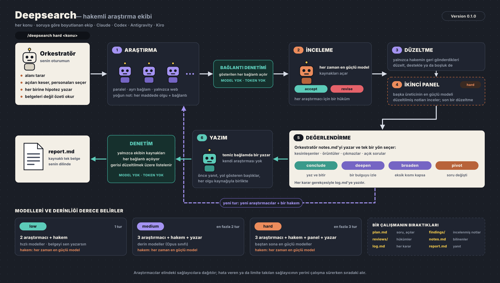

# deepsearch

**Bir konuyu ajan ekibiyle araştır; sonucu sen okumadan önce bir hakem incelesin.**
`/deepsearch hard <konu>` oturumunu bir araştırma ekibinin orkestratörüne çevirir: soruyu
netleştirir, ekibi soruya göre boyutlandırır, her araştırmacıya kendine ait bir persona ve bir
açı verir, onları webde paralel çalıştırır, notlarını en güçlü modeldeki bir hakeme verir; hakem
kaynakları açıp kontrol eder, tutmayanı geri gönderir; ayakta kalanlardan bir yazar, kaynakları
denetlenmiş tek bir belge çıkarır.

> 🇬🇧 English: [README.md](README.md)

```
/deepsearch hard Sodyum-iyon, şebeke depolamada LFP'nin yerini almaya hazır mı?
```

<p align="center">
  
</p>

**Claude Code, Codex, Antigravity ve Kiro**'da çalışır: masaüstü uygulaması, IDE ya da CLI.

## Nasıl çalışır

Bir çalışma, okuyabileceğin ve sonradan sürdürebileceğin bir klasör bırakır:

```
research/2026-11-13-sodyum-iyon-sebeke-depolamada-lfp-nin-yerini-almaya/
├── survey.md      orkestratörün plandan önce çıkardığı alan haritası
├── plan.md        soru, kapsam, her ajanın personası, açısı ve hipotezi
├── findings/      researcher-1.md …   yoğun, kaynaklı notlar; hakemden sonra düzeltilmiş hâli
├── reviews/       reviewer-1.md, panel-1.md
├── digest.md      çıkarımlar, boşluklar ve hükümler; belgelerden modelsiz kesilir
├── notes.md       çalışmanın bildiği: kesinleşenler, örüntüler, çıkmazlar, açık sorular
├── log.md         her aşama, hüküm, bağlantı denetimi ve karar, saatiyle
└── report.md      son belge
```

- **Ekibi derece belirler.** Sorunun ne kadarını hak ettiğine sen karar verirsin; derece
  yazmazsan sorar.

  | Derece | Ekip | Araştırmacıların modeli | Hakemin modeli | Tur |
  |---|---|---|---|---|
  | `low` | 2 araştırmacı + 1 hakem; belgeyi sen yazarsın | hızlı modeller (Sonnet, GPT-6.1 Sol, Gemini Flash) | en güçlü | 1 |
  | `medium` | 3 araştırmacı + 1 hakem + 1 yazar | derin modeller (Opus, GPT-6 Astra, Gemini 4 Argon) | en güçlü | en fazla 2 |
  | `hard` | 3 araştırmacı + 1 hakem + ikinci panel + 1 yazar | en güçlüler (Fable high, Astra high, Argon high) | en güçlü | en fazla 3 |

- **Kişi sayısını soru belirler.** Derece modelleri ve derinliği belirler; orkestratör sorunun
  bağımsız parçalarını sayar ve her biri için bir araştırmacı alır: birden (tek odaklı soru)
  sekize (kapsanacak büyük bir küme) kadar. Kendine ait açısı olmayan araştırmacı yalnızca
  aramaları tekrarlar.

- **Hakem hiçbir derecede ucuza bağlanmaz.** İnceleme her derecede ilk sağlayıcının en güçlü
  modelinde çalışır; `hard`'da ikinci panel, varsa başka bir üreticinin en güçlü modelinde. Hakem her
  sonucun dayandığı kaynakları açar ve her araştırmacı için bir kararla bitirir.
- **İşi olan personalar.** Her araştırmacı, açısının ait olduğu alanın ödüllü usta
  araştırmacısı gibi çalışır; hakem ise konunun temel kitabını yazmış profesör gibi. Persona
  çalışma standardını belirler. Asla gerçek bir kişinin adı değildir.
- **Bir yabancının yürütebileceği görevler.** Her araştırmacı temiz bir bağlamla başlar ve bir
  hedef, kendisine *ait olmayan* kısım, nereden başlayacağı, bir hipotez ve sorular alır.
  Orkestratör soruyu uzmanların sahipleneceği biçimde böler (kanıt, mekanizma, ekonomi, karşı
  görüş); ekip aynı modele birkaç kez sormaktan daha geniş alan tarar ve iki kişi aynı aramayı
  yapmaz.
- **Deneme değil, yoğun not.** Araştırmacılar her soruda bir çıkarım, madde başına tek olgu ve
  bağlantısı ile boşlukları döndürür; arama sayısı bütçelidir. Sonraki herkes daha az okur, her
  iddia kaynağıyla karşılaştırılabilir.
- **Temiz bağlamda bir yazar.** `medium` ve `hard`'da son belgeyi, yalnızca incelenmiş notları,
  hakem raporlarını ve orkestratörün notlarını gören bir ajan yazar: önce yanıt, savı taşıyan
  başlıklar, her olgu kaynağıyla birlikte.
- **Token harcamayan denetimler.** İncelemeden önce betik gösterilen her bağlantıyı açar ve
  hakeme hangilerinin var olmadığını söyler. Yazımdan sonra, belgede olup ekibin hiç göstermediği
  her kaynağı ve açılmayan her bağlantıyı listeler.
- **Hipotezler aramadan önce yazılır.** Her araştırmacıya açısı için beklenen yanıt ve onu neyin
  çürüteceği verilir; araştırma başlarken plan olduğu gibi kopyalanır. Arama, yanıta uyacak
  biçimde sessizce eğilemez; çürüyen hipotez de bir bulgudur.
- **Gerektiğinde yeniden bakar, gerektiğinde durur.** Bir turdan sonra orkestratör neyin
  kesinleştiğini ve neyin açık kaldığını yazar (`notes.md`), sonra karar verir: bitir, bir
  bulguyu derinleştir (deepen), kapsanmayan kısma genişle (broaden) ya da asıl soru başka çıktıysa
  yön değiştir (pivot). Yeni tur tam bunun için araştırmacı ve hakem ekler; tur sayısını derece
  sınırlar, yani çalışma sonsuza kadar dönemez.
- **Sonradan sürdürülebilen çalışma.** `notes.md` çalışmanın bildiğini, `log.md` her aşamayı,
  hükmü ve kararı tutar. Yeni bir oturumda `/deepsearch resume` bunlardan devam eder.
- **Son belgeye yalnızca incelemeden geçen girer.** Hakemin reddettiği ve araştırmacısının
  destekleyemediği iddia son belgeye alınmaz ya da "doğrulanmadı" diye işaretlenir.
- **Birkaç sağlayıcı, tek ekip.** Araştırmacılar elindeki sağlayıcılara dağıtılır; ekip tek bir
  modelin kör noktalarını paylaşmaz. Kullanım limitine takılan ya da modeli olmayan sağlayıcının
  yerini, çalışma sürerken sıradaki alır.
- **Yalnızca web araçları.** Ajanlar webde arar ve okur. Dosya düzenleyemez, komut çalıştıramaz;
  skill hiçbir CLI'a izin kontrolünü atlatan bir bayrak vermez.

## Kurulum

Gereksinimler: Python 3.8+ ve çağırmak için Claude Code, Codex, Antigravity ya da Kiro'dan biri
(masaüstü uygulaması, IDE ya da CLI). Ekip arka planda sağlayıcıların CLI'ları üzerinden çalışır
(`claude`, `codex`, `agy`, `kiro-cli`): her birinin kurulu ve giriş yapılmış olması yeterli.
Hiçbiri kurulu değilse çağırdığın oturum bütün rolleri sırayla kendisi oynar: yine çalışır, ama
araştırmacılar artık birbirinden bağımsız olmaz. macOS, Linux ve WSL.

```bash
git clone https://github.com/osrbck/skillbook.git ~/skillbook
~/skillbook/install.sh deepsearch          # Claude Code
~/skillbook/install.sh deepsearch --codex  # Codex (ayrıca: Antigravity için --agy, Kiro için --kiro)
~/skillbook/install.sh deepsearch --all    # Claude Code, Codex, Antigravity ve Kiro
```

## Kullanım

```
/deepsearch low AB pil yönetmeliğinde 2026'da ne değişti?
/deepsearch medium 50 milyon belgelik bir RAG sistemi için vektör veritabanlarını karşılaştır
/deepsearch hard Aralıklı oruç kalori kısıtlamasından üstün mü? RCT'ler ne diyor?
/deepsearch Perovskit güneş hücrelerinde son durum ne?     (dereceyi sorar)

/deepsearch medium … önceki çalışmanın üzerine      (ekip o belgeyi arka plan olarak alır)

/deepsearch setup      sağlayıcıları ve modelleri seç; her derecenin ekibini gösterir
/deepsearch verify     her modele ping atar, web aramasının çalıştığını kontrol eder
/deepsearch roster     her derecede kim araştırıyor, kim inceliyor
/deepsearch init       bu projenin ayarları: klasör, dil, odak, kaynaklar
/deepsearch status     son çalışma nerede; `resume` kaldığı yerden sürdürür
```

Setup yapmadan da çalışır: bulduğu CLI'ları varsayılan kadroyla kullanır.

### Ekibi değiştirmek

İstediğin zaman düz cümleyle söyle:

```
/deepsearch incelemeyi Codex yapsın
/deepsearch hard'da beş araştırmacı ve iki panel hakemi kullan
/deepsearch Kiro'da en güçlü model olarak claude-opus-5.5 kullan
/deepsearch en güçlü modellere bir saat ver
```

Arkasında elle de çalıştırabileceğin `setup` bayrakları var:

```bash
R="python3 ~/.claude/skills/deepsearch/scripts/deepsearch.py"
$R setup --providers claude,codex,agy,kiro        # hangi sağlayıcılar, tercih sırasıyla
$R setup --model kiro:top=claude-opus-5.5         # bir kademenin modeli: fast | deep | top  (@efor eklenebilir)
$R setup --role reviewer=codex,claude             # kim inceler, sırayla
$R setup --degree hard:researchers=5,panel=2      # ayrıca reviewers=, cycles=, tier=, writer=, calls=, words=
$R setup --links off                              # otomatik bağlantı denetimini kapat
$R setup --timeout top=60                         # ajan başına dakika
$R verify                                         # hesabında olmayanları kadrodan çıkarır
```

Kadro `~/.config/deepsearch/config.json` dosyasında durur.

### Proje ayarları

`/deepsearch init`, bir projeye ait araştırmalar için bulunduğun klasöre `.deepsearch.json`
yazar:

```json
{
  "output": "docs/research",
  "language": "Turkish",
  "focus": "Bir sonraki hücre kimyasını seçen bir şebeke depolama girişimi",
  "citation": "numaralı bağlantılar",
  "prefer_sources": ["hakemli yayınlar", "IEA", "üretici veri sayfaları"],
  "avoid_sources": ["basın bültenleri"]
}
```

Bu dosya projeyi tarif edebilir ve sağlayıcıları daraltabilir (`allowed_providers`). Çalıştırılan
programları, modelleri ya da ekip büyüklüğünü değiştiremez, çalışmaları projenin dışına
yazdıramaz: bunlar yalnızca senin kendi ayarından gelir.

## Maliyeti ve neden böyle kuruldu

Anthropic, çok ajanlı bir araştırma çalışmasının bir sohbetin yaklaşık 15 katı token
harcadığını ve kalitenin büyük kısmını harcanan token'ın açıkladığını söylüyor. Deepsearch o
tasarımın kaliteyi getiren kısımlarını tutar (kendi bağlamında bağımsız araştırmacılar, net
görevler, güçlü bir lider) ve token'ı işe yaradığı yere harcar:

| | Düz orkestratör-işçi çalışması | Deepsearch |
|---|---|---|
| Ekip büyüklüğü | alışkanlıkla 3–5 araştırmacı | sorunun her bağımsız parçası için bir kişi, 1'den başlar |
| Araştırmacı çıktısı | serbest notlar | madde başına tek olgu ve bağlantısı, arama bütçesi |
| Kalite kontrolü | lider her şeyi okur | en güçlü modeldeki hakem kaynakları açar; yalnızca geri gönderdiği yeniden yapılır |
| Ölü ya da uydurma bağlantı | okuyan fark ederse | incelemeden önce betik açar: model yok, token yok |
| Liderin okuduğu | her belge | mekanik kesilmiş özet (canlı çalışmada metnin yaklaşık üçte biri) |
| Son belge | bütün notlardan yazılır | temiz bağlamda, incelenmiş notlardan yazılır; sonra ekibin gösterdikleriyle karşılaştırılır |
| Ek araştırma | "gerekirse bir tur daha" | adı konmuş bir yön (deepen, broaden, pivot), derece sınırlar |
| Modeller | tek aile | genişlik ucuz kademede, yargı en güçlüde, dört sağlayıcıda |

Tahmin değil, ölçüm: canlı `medium` çalışması (Opus ve Gemini 4 Argon'da iki araştırmacı, Fable
hakem, tek düzeltme, Opus yazar) altı ajan çalıştırması ve yaklaşık on bir dakika sürdü;
belgesi 19 kaynak gösterdi, hepsi ekibin gösterdiği ve açılan kaynaklardı. Anthropic'in
sistemiyle karşılaştırmalı bir ölçüm yapılmadı: iddia token'ın nereye gittiği hakkında, bir
puan hakkında değil.

Kabaca: `low` hızlı modellerde en fazla dört, güçlü modelde bir ajan çalıştırması; `medium` en
fazla sekiz; `hard`'da ilk tur elindeki en güçlü modellerde on ikiye kadar, sonraki her tur en
fazla beş tane daha. Hızlı bir fikir için `low` kullan; `hard`'ı yanılmanın pahalı olduğu
sorulara sakla.

## Durum

| Parça | Durum |
|---|---|
| Claude Code, Codex, Antigravity, Kiro | her model ve web araması gerçek CLI'larda doğrulandı; iş akışının tamamı simülasyon testleriyle kapsanıyor |
| Tam bir çalışma | `low` (Claude Code ve Codex araştırmacıları) ve `medium` (Claude Code ve Antigravity araştırmacıları, Claude hakem ve yazar, bağlantı ve kaynak denetimi) derecelerinde canlı yapıldı |
| `hard`, ek turlar | simülasyon testleriyle kapsanıyor; henüz canlı çalıştırılmadı |
| Kiro araç izinleri | `kiro-cli` 3.x'in `--trust-tools` kalıplarına dayanıyor |

## Teşekkür

Ekip tasarımı (kendi bağlamında paralel çalışan araştırmacılara iş dağıtan bir orkestratör,
sınırları belli net görevler, soruya göre boyutlanan ekip, yoğun ve kaynaklı notlar, ayrı bir
yazar) Anthropic'in
[How we built our multi-agent research system](https://www.anthropic.com/engineering/multi-agent-research-system)
yazısını ve `deep-research` skill'ini izler. Deepsearch buna hakemi, hipotezleri, turları ve
mekanik denetimleri ekler ve dört sağlayıcıda çalışır.

Araştırma yöntemi (plandan önce alan taraması, aramadan önce sabitlenen hipotezler, neyin
kesinleştiğinin ve neyin elendiğinin sürekli kaydı, her turdan sonra derinleş / genişle / yön
değiştir / bitir kararı)
[Orchestra Research'ün AI-Research-SKILLs](https://github.com/Orchestra-Research/AI-Research-SKILLs)
deposundaki `autoresearch` skill'ini izler (MIT); makine öğrenmesi deneylerinden web
araştırmasına uyarlandı. Oradan metin ya da kod alınmadı.

Bkz. [CHANGELOG.md](CHANGELOG.md) ve [CONTRIBUTING.md](CONTRIBUTING.md).
